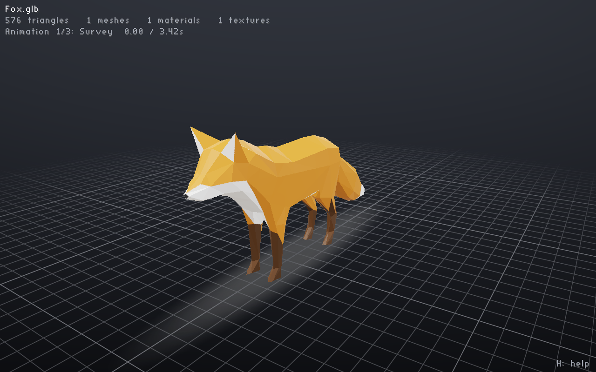

# gltfviewer

A small native glTF 2.0 viewer for Linux and Omarchy, built with SDL3 and OpenGL 3.3. It opens `.gltf` and `.glb` files and renders them in real time.



<sub>Fox model: PixelMannen (CC0), rigging and animation by tomkranis (CC BY 4.0), conversion by @AsoboStudio and @scurest (CC BY 4.0). Taken from the [Khronos glTF Sample Assets](https://github.com/KhronosGroup/glTF-Sample-Assets/tree/main/Models/Fox).</sub>

## Build & install

```sh
make install        # installs to ~/.local, registers the .desktop file, sets it as default for glTF
```

After installing, double-click a `.gltf` or `.glb` file in Files (Nautilus) to open it. To remove it, run `make uninstall`.

Dependencies (already on Omarchy): `sdl3`, `mesa`, `gcc`, `pkg-config`. The `third_party/` folder vendors `cgltf`, `stb_image`, `stb_image_write` and `stb_easy_font`.

## Usage

```sh
gltfviewer model.glb
gltfviewer --screenshot out.png model.gltf   # render one frame offscreen to a PNG
```

| Input | Action |
|---|---|
| Left drag | Orbit |
| Right / middle drag, Shift + left drag | Pan |
| Scroll | Zoom |
| F / double-click | Frame model |
| R | Reset view |
| A | Auto-rotate |
| G | Toggle grid |
| W | Wireframe |
| Space | Play / pause animation |
| N / P | Next / previous animation |
| O | Open file dialog |
| F11 | Fullscreen |
| H | Help overlay |
| Q / Esc | Quit |

You can also drag and drop a file onto the window.

## Supported

- Metallic-roughness PBR with base color, metal/rough, normal, occlusion and emissive maps. Spec-gloss materials get an approximate conversion.
- Alpha modes opaque, mask and blend (blended geometry is sorted back to front), and double-sided materials.
- `KHR_materials_unlit`, `KHR_materials_emissive_strength` and `KHR_materials_specular` (factors only).
- Embedded, data-URI and external buffers and images.
- Node animation (step, linear and cubic-spline) and skinning.

**Not supported yet:** morph targets, Draco or meshopt compression, KTX2 or WebP textures, `KHR_texture_transform`, and lights or cameras defined in the file.

## License

Public domain ([Unlicense](LICENSE)). The libraries in `third_party/` keep their own licenses (MIT or public domain).
